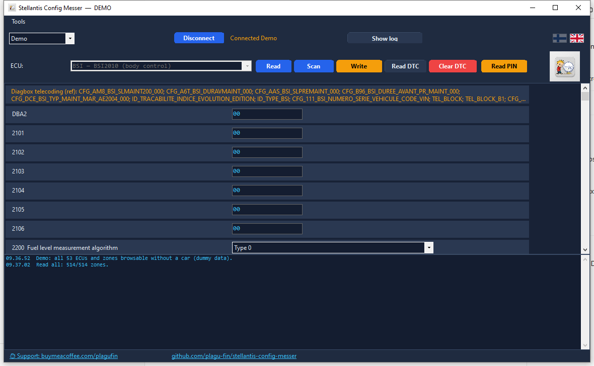

# Stellantis Config Messer

A native Windows app for reading and writing (telecoding) configuration **zones** on
PSA/Stellantis ECUs (Peugeot, Citroën, DS, Opel on the PSA platform), Diagbox-style —
with human-readable field names, toggles and drop-downs instead of raw hex.

It talks to the car over the diagnostic CAN bus through one of four **interfaces**: a cheap
**Arduino + MCP2515** running the [ludwig-v/arduino-psa-diag](https://github.com/ludwig-v/arduino-psa-diag)
firmware, a **Diagbox / Evolution XS VCI** (via the `VCIAccess.dll` that ships with Diagbox),
a generic **ELM327** adapter, or **Demo** mode (browse every ECU and zone with no car attached).



> ☕ If this saved you a trip to the dealer: **https://www.buymeacoffee.com/plagufin**

---

## What it does

- **Browse & edit config zones** of many ECUs (BSI, ESP/ABS, instrument cluster,
  VCU, parking-assist, steering, radar, camera, RCC/NAC infotainment, engine/INJ,
  gearbox, airbag, climate, …) with decoded fields:
  - on/off settings → **toggle buttons**
  - multi-value settings → **drop-downs**
  - everything else → guarded **hex** field (raw hex is always shown)
- **53 ECUs auto-discovered** from the open PyPSADiag field maps (petrol & diesel variants
  included); 9 are car-verified, the rest are read-anywhere with best-effort write keys.
- **Bus probe on connect** — only the ECUs that actually answer are listed, so you don't
  scroll past 53 modules that aren't in your car.
- **Read all zones** of a module in one click (fast, non-blocking).
- **Scan** — discover hidden zones (2100–23FF) on any ECU.
- **Automatic seed→key unlock** (ludwig-v / prototux algorithm) — no need to know the key.
- **Read-before-write guard**, verify-after-write, and **Secured Traceability (2901)**
  stamping in the same session.
- **Automatic backup** of the current configuration before every write
  (`backup\<VIN>\<ECU>\<timestamp>.csv`).
- **Restore from backup** (Tools menu) — load a backup CSV, diff against the live config and
  write back the differing zones in one go.
- **DTC read / clear** with decoded fault codes (Bxxxx / Uxxxx + FTB + status) from the
  open DTC description set; unknown codes fall back to the bare number.
- **Diagbox DataRipper** (Tools menu, optional) — if a local Diagbox install is present it
  rips its telecoding parameter names into a local overlay the app then uses; otherwise it
  just says so. No Diagbox data is bundled.
- **Four interfaces**: Arduino (serial), Diagbox VCI, ELM327, or Demo — pick from the top bar.
- Reads and shows the **VIN** in the title bar.
- **Modern dark UI**, English / Finnish, and settings (language, interface, port) are
  remembered across restarts in `StellantisConfigMesser.ini`.

## Requirements

- Windows with **.NET Framework 4.x** (already present on modern Windows) — the app is
  a single native `.exe`, no install.
- An **interface**, one of:
  - Arduino Uno + MCP2515 CAN shield flashed with
    [arduino-psa-diag](https://github.com/ludwig-v/arduino-psa-diag) (115200 baud), **or**
  - a Diagbox / Evolution XS VCI with `C:\AWRoot\drv\VCIAccess.dll` (installed by Diagbox).
    The app must be built/run as **x86** to load the 32-bit DLL (see below), **or**
  - a generic **ELM327** adapter (experimental), **or**
  - none at all — use **Demo** mode to explore the ECU/zone catalogue offline.
- An OBD adapter wiring the correct CAN-DIAG pins (3/8 on older PSA, 6/14 on newer).

## Settings (`StellantisConfigMesser.ini`, next to the exe)

```
[settings]
lang=fi|en
transport=Arduino|Diagbox VCI|ELM327|Demo
port=COMx
pin=0|1      ; 1 shows the immobiliser PIN-read button (your own car only); default 0
```

## Build

No IDE needed — compile with the C# compiler that ships with .NET Framework:

```
C:\Windows\Microsoft.NET\Framework64\v4.0.30319\csc.exe /platform:x86 /target:winexe ^
  /out:StellantisConfigMesser.exe /win32icon:app.ico ^
  /reference:System.Windows.Forms.dll /reference:System.Drawing.dll ^
  /reference:System.Web.Extensions.dll /reference:System.Management.dll ZoneTool.cs
```

`/platform:x86` is required so the app can P/Invoke the 32-bit Diagbox `VCIAccess.dll`.
(The Arduino, ELM327 and Demo interfaces work regardless.) The source is pure-ASCII
(non-ASCII text is `\uXXXX`-escaped) so it compiles identically whatever the system codepage.

## Zone map (`zones.json`)

The app is data-driven: it reads `zones.json` describing modules, keys, zones and fields,
plus `dtc.json` for fault-code descriptions. Generate both with:

```
powershell -ExecutionPolicy Bypass -File build-zones.ps1
```

`build-zones.ps1` is **self-contained**: it downloads every field map from
[Barracuda09/PyPSADiag](https://github.com/Barracuda09/PyPSADiag) — including the BSI2010
body-control map and the TELEMAT/RCC infotainment map — and the DTC description set, then
converts them to the app's schema. **No Diagbox required**, and every field map ships from
open sources. (Pre-built releases ship a ready-made `zones.json` / `dtc.json`.)

## ⚠️ Disclaimer

Telecoding ECUs can misconfigure or, in rare cases, brick modules, and can enable features
your car's hardware does not support. **Use entirely at your own risk**, on a vehicle you
own, with a stable power supply. Always keep the automatic backups. The authors take no
responsibility for any damage. This project is not affiliated with Stellantis/PSA.

## Credits

This project stands on the shoulders of the PSA reverse-engineering community:

- **[Barracuda09/PyPSADiag](https://github.com/Barracuda09/PyPSADiag)** — zone/field JSON
  maps, DTC descriptions, VCI transport design, and overall reference. (GPL)
- **[ludwig-v/arduino-psa-diag](https://github.com/ludwig-v/arduino-psa-diag)** — the Arduino
  diagnostic firmware and ECU zone/key documentation.
- **[ludwig-v/psa-seedkey-algorithm](https://github.com/ludwig-v/psa-seedkey-algorithm)** —
  seed/key algorithm and ECU key list.
- **[prototux/PSA-RE](https://github.com/prototux/PSA-RE)** — the UDS security (seed/key)
  algorithm source and constants.
- **[halloworld007/PyPSADiag-VCI](https://github.com/halloworld007/PyPSADiag-VCI)** — the
  Evolution XS / Diagbox VCI (`VCIAccess.dll`) access approach reused by PyPSADiag.
- **Diagbox / Lexia (Stellantis)** — the `VCIAccess.dll` driver used by the VCI interface is
  part of Diagbox and is **not** distributed here.

## License

GPL-3.0 — see [LICENSE](LICENSE). (Derived in part from GPL-licensed PyPSADiag.)

### KWP2000 / Older PSA Support (2004–2010)
- Added full KWP2000 definitions for **BSI2004** (Body Control), **CMB2004** (Instrument Cluster), and **EMF2004** (Multifunction Display), **RD4_2004** (Radio/AUX), **CLIM_2004** (Climate Control), **AAS_2004** (Parking Aid), and **BSM_2004** (Engine Fusebox) with English & Finnish descriptions.
- Added KWP2000 / BSI2004 fault code descriptions to dtc.json and KWP2000 Demo mode support.
